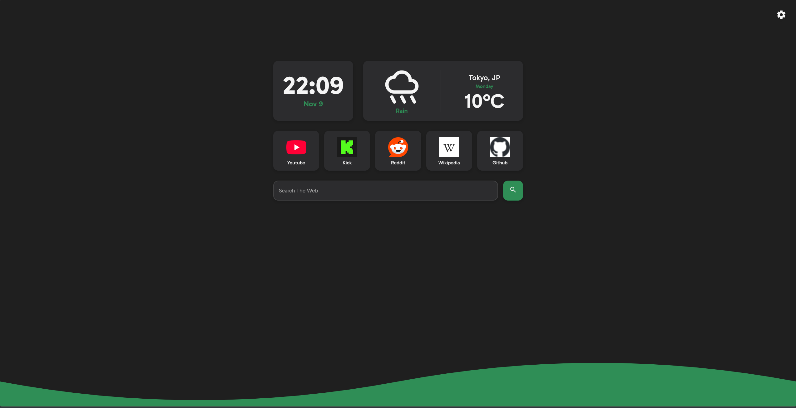

# Startpage

A small personal homepage I keep open in a new tab. It shows the time, the weather, a search box,
and a row of pinned links. That's it.



> Drop a real screenshot named `screenshot.png` in the project root if you want the preview image to
> show up.

## What it does

This is a one-screen SvelteKit app meant to replace your default new-tab page. Everything you change
is saved in your browser's localStorage, so there's no backend, no account, and nothing is sent
anywhere except the weather API request.

## Features

- **Clock and date** on a dark card.
- **Weather** for any city you type in, powered by OpenWeatherMap.
- **Search bar** that works with any search engine URL. Brave is the default.
- **Pinned links** with favicons. You can edit the title and URL of each tile in Settings.
- **Five accent colors** to pick from.
- **Two backgrounds**: a plain color or a little SVG wave at the bottom.
- **Mobile-friendly**: the layout collapses to a single column on small screens.
- **Settings persist** between visits through localStorage.

## Getting started

You need Node 20 or newer and npm.

```sh
git clone https://github.com/E3TU/startpage.git
cd startpage
npm install
```

### Weather API key

The weather widget needs a free API key from [OpenWeatherMap](https://openweathermap.org/api).
Once you have one, copy the example file and paste your key in:

```sh
cp .env.example .env
```

```env
VITE_API_KEY=your_openweathermap_api_key
```

Without a key, the weather widget will show an error and a retry button. Everything else still works.

### Run the dev server

```sh
npm run dev
```

Open the URL it prints, usually `http://localhost:5173`.

## Scripts

| Command           | What it does                              |
| ----------------- | ----------------------------------------- |
| `npm run dev`     | Start the dev server with hot reload.     |
| `npm run build`   | Build a production version.               |
| `npm run preview` | Preview the production build locally.     |
| `npm run check`   | Type-check the project with svelte-check. |
| `npm run lint`    | Check formatting with Prettier.           |
| `npm run format`  | Format everything with Prettier.          |

## Tech stack

- [SvelteKit](https://kit.svelte.dev/)
- [Svelte 5 runes](https://svelte.dev/docs/svelte/what-are-runes)
- TypeScript
- [Vite](https://vitejs.dev/)
- [adapter-auto](https://kit.svelte.dev/docs/adapters) for deployment

## Project structure

```
src/
├── app.css              # global styles and accent color variables
├── components/          # Clock, Weather, Links, Search, Settings
├── lib/
│   ├── state/           # rune-based state modules
│   └── assets/          # favicon
└── routes/              # the page itself
```

## Customizing

Open the Settings panel from the gear icon in the top-right corner.

- **Accent color**: pick from red, orange, purple, blue, or green.
- **Background**: switch between a solid color and the SVG wave.
- **Search engine**: change the URL. Make sure it ends with `?q=` or `=` so your search term is
  appended correctly.
- **Pinned sites**: edit the title and link for each tile. Titles longer than a few characters will
  be truncated on mobile.
- **Weather city**: enter any city name OpenWeatherMap understands.

## Deploying

```sh
npm run build
```

The project uses `adapter-auto`, so the production build works on Vercel, Netlify, Cloudflare
Pages, and a few other hosts without changes. If your host is not supported, swap the adapter in
`svelte.config.js` for the one you need.

## Privacy

- All settings are stored in your browser's localStorage.
- The only external requests are:
  - OpenWeatherMap for weather data.
  - Google's favicon service for the link icons.
  - The search engine you choose when you submit a search.

## Contributing

This is a personal side project, but feel free to fork it, change it, or open a pull request if you
fix something.

## License

[MIT](LICENSE)
